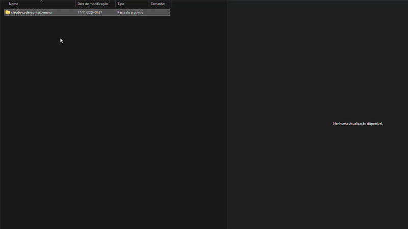

# Abrir aqui no Claude Code

Adiciona ao menu de contexto do Windows a opção "Abrir aqui no Claude Code". Você clica com o botão direito numa pasta e o [Claude Code](https://claude.com/claude-code) abre numa janela nova, já dentro dela.



No Windows 11, segure Shift ao clicar com o botão direito do mouse para a opção aparecer. O menu da sua máquina pode ter outra aparência.

## Antes de instalar

A máquina precisa ter:

- Windows 10 ou 11.
- [Windows Terminal](https://aka.ms/terminal). O Windows 11 já vem com ele. No Windows 10, instale pela Microsoft Store.
- Claude Code, com o comando `claude` funcionando no terminal.

O instalador avisa se não encontrar o Windows Terminal ou o `claude`.

## Instalação

1. Baixe este repositório pelo botão verde "Code", opção "Download ZIP", e extraia o arquivo em qualquer pasta. Quem usa git pode clonar:

   ```
   git clone https://github.com/miguel-arrls/claude-code-context-menu.git
   ```

2. Abra a pasta e dê dois cliques em `instalar.cmd`. Se o Windows mostrar um aviso por ser um arquivo baixado da internet, confirme a execução.

3. Quando aparecer "Pronto", feche a janela.

A instalação não pede administrador nem reinício. Depois dela a pasta baixada pode ser apagada, porque o instalador copia o que precisa para `%LOCALAPPDATA%\ClaudeCodeContextMenu`.

## Como usar

Segure Shift e clique com o botão direito do mouse numa pasta, ou num espaço vazio dentro dela. Depois escolha "Abrir aqui no Claude Code".

O Shift é necessário no Windows 11, onde a opção fica no menu clássico. Sem ele, ela só aparece depois de clicar em "Mostrar mais opções". No Windows 10 o clique direito comum basta.

O Claude Code abre numa janela nova do Windows Terminal, naquela pasta. Quando você sai do Claude, a janela fecha.

## Remover

Dê dois cliques em `remover.cmd`, na pasta que você baixou. Se já apagou a pasta, rode este comando no PowerShell:

```powershell
powershell -ExecutionPolicy Bypass -File "$env:LOCALAPPDATA\ClaudeCodeContextMenu\remover.ps1"
```

Os dois caminhos tiram a opção do menu e apagam os arquivos copiados na instalação.

## Se algo não funcionar

- A opção não aparece no Windows 11. Ela fica no menu clássico: use Shift com o botão direito.
- A janela abre com uma mensagem de erro ao iniciar o `claude`. O Windows Terminal não achou o comando. Abra um terminal, rode `claude --version` e, se falhar, reinstale o Claude Code.

## O que o instalador faz

Ele grava duas chaves no registro do seu usuário, uma para o clique numa pasta e outra para o clique no fundo de uma pasta:

```
HKCU\Software\Classes\Directory\shell\ClaudeCode
HKCU\Software\Classes\Directory\Background\shell\ClaudeCode
```

As duas executam o mesmo comando:

```
wt.exe -w -1 -d "%V." claude
```

`-w -1` pede sempre uma janela nova e `-d` define a pasta de trabalho. O ponto depois de `%V` existe por causa das raízes de unidade: em `C:\`, a barra final escaparia a aspa de fechamento.

O ícone e o `remover.ps1` ficam em `%LOCALAPPDATA%\ClaudeCodeContextMenu`. Fora essa pasta e as duas chaves, o instalador não altera nada.

## Refazer o ícone

O script `ferramentas\gerar-icone.ps1` desenha o `claude-code.ico` em pixel art, de 16 a 256 px. Ele só precisa do PowerShell.

## Aviso

Projeto pessoal, sem vínculo com a Anthropic. "Claude" e "Claude Code" são marcas da Anthropic, e o ícone é uma reprodução em pixel art do mascote do Claude Code. O código está sob a licença [MIT](LICENSE).
